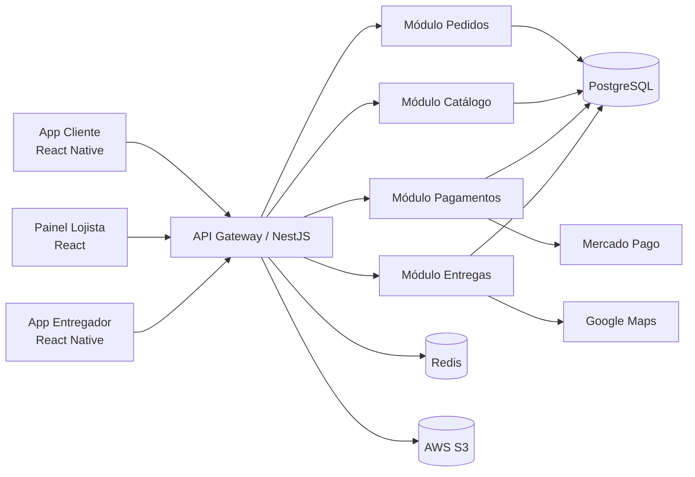
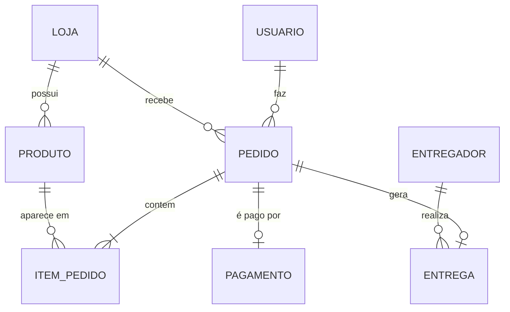

# PedeAi
# PedeAí

> Plataforma de delivery focada no *comércio local*: restaurantes, padarias, mercadinhos e lojas de bairro de cidades pequenas e médias, com taxas menores que os grandes apps.


---

# Sumário
1. [Sobre o Projeto](#-sobre-o-projeto)
2. [Funcionalidades](#-funcionalidades)
3. [Tecnologias, Ferramentas e Infraestrutura](#-tecnologias-ferramentas-e-infraestrutura)
4. [Arquitetura](#-arquitetura)
5. [Metodologias Utilizadas](#-metodologias-utilizadas)
6. [Projeto de Interface](#-projeto-de-interface)
7. [Estrutura de Pastas](#-estrutura-de-pastas)
8. [Como Executar](#-como-executar)
9. [Roadmap](#-roadmap)
10. [Autor](#-autor)

---

## Sobre o Projeto

O **PedeAí** é um clone simplificado do iFood, pensado para cidades onde os grandes aplicativos cobram taxas altas ou nem chegam. A plataforma conecta três tipos de usuário:

- **Clientes**: buscam estabelecimentos, montam o pedido, pagam e acompanham a entrega em tempo real.
- **Lojistas**: cadastram o cardápio, recebem e gerenciam pedidos e visualizam relatórios de vendas.
- **Entregadores**: aceitam corridas, seguem a rota e confirmam a entrega.

**Problema que resolve:** pequenos comerciantes ficam dependentes de apps que retêm uma fatia grande do valor de cada pedido. O PedeAí oferece uma alternativa com comissão reduzida e foco na economia local.

**Objetivos do projeto**

- Praticar a modelagem e o desenvolvimento de um sistema completo, do requisito à entrega.
- Aplicar boas práticas de engenharia de software, versionamento e documentação.
- Construir uma arquitetura que comece simples e possa escalar.

---

## Funcionalidades

| Perfil | Funcionalidades |
|---|---|
| Cliente | Cadastro/login, busca por loja e categoria, carrinho, cupom de desconto, pagamento (Pix e cartão), acompanhamento do pedido em tempo real, histórico e avaliação |
| Lojista | Cadastro da loja, gestão de cardápio e estoque, aceitar/recusar pedidos, horário de funcionamento, relatório de vendas |
| Entregador | Cadastro, receber chamadas de corrida, rota no mapa, confirmação de entrega, extrato de ganhos |
| Administrador | Aprovação de lojas, gestão de usuários, métricas gerais da plataforma |

---

## Tecnologias, Ferramentas e Infraestrutura

| Camada | Tecnologia | Por que foi escolhida |
|---|---|---|
| Front-end web | **React + TypeScript** | Componentização e tipagem para evitar erros |
| App mobile | **React Native** | Reaproveita conhecimento do React e gera app Android/iOS |
| Back-end | **Node.js + NestJS** | Estrutura modular, bom suporte a TypeScript e a APIs REST |
| Banco de dados principal | **PostgreSQL** | Relacional, transações seguras (essencial para pedidos e pagamentos) |
| Cache e filas | **Redis** | Cache de cardápios, sessões e fila de notificações |
| Tempo real | **WebSocket (Socket.IO)** | Atualização do status do pedido e posição do entregador |
| Mapas e rotas | **Google Maps API** | Geolocalização, cálculo de rota e de taxa de entrega |
| Pagamentos | **Mercado Pago API** | Pix, cartão e split de pagamento entre loja e plataforma |
| Autenticação | **JWT + bcrypt** | Sessões stateless e senhas protegidas |
| Armazenamento de imagens | **AWS S3** | Fotos de produtos e lojas |
| Containers | **Docker + Docker Compose** | Ambiente igual em qualquer máquina |
| Cloud | **AWS** (EC2, RDS, S3, CloudFront) | Serviços gerenciados e escaláveis |
| CI/CD | **GitHub Actions** | Testes e deploy automáticos a cada merge |
| Testes | **Jest** (unitários) e **Cypress** (E2E) | Garantem qualidade a cada entrega |
| Monitoramento | **Grafana + Prometheus** | Métricas de desempenho e alertas |
| Design | **Figma** | Protótipos de telas |
| Gestão do projeto | **GitHub Projects** (Kanban) | Backlog e acompanhamento das tarefas |

---

## Arquitetura

O sistema começa como um **monólito modular** (um único deploy, mas com módulos bem separados). Isso reduz a complexidade no início e permite extrair módulos em microsserviços no futuro, caso necessário.



### Modelo de dados (resumo)



---

## Metodologias Utilizadas

### Modelo de processo: Espiral (com práticas ágeis)

Escolhi o **Modelo Espiral** em vez do **Cascata** pelos seguintes motivos:

- **Requisitos que mudam.** Em um app de delivery, o feedback de clientes e lojistas altera prioridades com frequência. No Cascata, uma mudança descoberta no fim do projeto é cara; no Espiral, cada volta reavalia o que foi construído.
- **Riscos técnicos relevantes.** Pagamentos, geolocalização e tempo real são pontos de risco. O Espiral tem uma etapa explícita de **análise de riscos** em cada ciclo, o que permite validar essas partes com protótipos antes de investir pesado.
- **Entregas incrementais.** Cada volta gera uma versão funcional (um MVP cada vez mais completo).

| Volta | Foco | Resultado |
|---|---|---|
| 1 | Cadastro, login, catálogo e carrinho | MVP navegável |
| 2 | Pedido + pagamento Pix | Compra completa |
| 3 | Painel do lojista e gestão de pedidos | Lado da loja funcionando |
| 4 | Entregador, mapa e tempo real | Fluxo ponta a ponta |
| 5 | Avaliações, cupons e relatórios | Versão 1.0 |

Em cada volta seguimos as 4 fases do Espiral:
1. **Planejamento**: definir objetivos e requisitos da volta.
2. **Análise de riscos**: identificar o que pode dar errado e prototipar se necessário.
3. **Engenharia**: projetar, codificar e testar.
4. **Avaliação**: revisar com o "cliente" (usuários de teste) e planejar a próxima volta.

> **Cascata** seria mais adequado para projetos com requisitos fixos e bem conhecidos desde o início (ex.: sistema de um órgão público com contrato fechado). Não é o caso aqui.
### Práticas ágeis complementares

- **Kanban** no GitHub Projects (colunas: Backlog → Em andamento → Em revisão → Concluído).
- **Sprints curtas de 2 semanas** dentro de cada volta do Espiral.
- **Histórias de usuário** como formato dos requisitos. Exemplo: *"Como cliente, quero acompanhar meu pedido em tempo real para saber quando ele vai chegar."*

### Uso do Git e do GitHub
**Estratégia de branches (GitHub Flow adaptado)**
```
main        ← versão estável, sempre pronta para deploy
 └─ develop ← integração das funcionalidades
     ├─ feature/carrinho-de-compras
     ├─ feature/pagamento-pix
     ├─ fix/erro-calculo-frete
     └─ docs/atualiza-readme
```
**Regras do fluxo**
1. Nunca commitar direto na `main`; toda mudança entra via **Pull Request**.
2. Cada tarefa do Kanban gera uma branch própria (`feature/`, `fix/`, `docs/`, `refactor/`).
3. Todo PR precisa passar nos testes do **GitHub Actions** antes do merge.
4. Releases marcadas com **tags semânticas** (`v1.0.0`, `v1.1.0`...).

**Padrão de commits (Conventional Commits)**
```
feat: adiciona tela de carrinho
fix: corrige cálculo da taxa de entrega
docs: atualiza instruções de instalação
refactor: separa lógica de pagamento em serviço
test: adiciona testes para módulo de pedidos
```

**Outras ferramentas do GitHub utilizadas:** Issues (tarefas e bugs), Projects (Kanban), Actions (CI/CD), Releases e Wiki.

---

##  Projeto de Interface

Os protótipos de alta fidelidade ficam no Figma: **[link do protótipo no Figma](#)** *(substituir pelo link real)*.
Abaixo, os wireframes das principais telas.

### 1. Tela inicial (Cliente)

```
┌──────────────────────────────────┐
│    Entregar em: Rua das Flores   │
│ ┌───────────────────────────┐    │
│ │  Buscar loja ou prato     │    │
│ └───────────────────────────┘    │
│                                  │
│                                  │
│ Lanches  Pizza  Padaria Mercado  │
│                                  │
│ ── Promoções ────────────────    │
│ ┌───────────────────────────┐    │
│ │   Frete grátis hoje!      │    │
│ └───────────────────────────┘    │
│                                  │
│ ── Lojas perto de você ──────    │
│ ┌──────┐ Burger do Zé            │
│ │ foto │  4.8 · 25-35 min        │
│ └──────┘ Frete R$ 3,99           │
│ ┌──────┐ Pizzaria Napoli         │
│ │ foto │  4.6 · 30-40 min        │
│ └──────┘ Frete R$ 5,00           │
│                                  │
│ Início   Busca   Pedidos   Perfil│
└──────────────────────────────────┘
```

### 2. Cardápio da loja

```
┌───────────────────────────────┐
│    Burger do Zé               │
│    4.8 · Lanches · 25-35 min  │
│ ───────────────────────────── │
│ [Combos] [Burgers] [Bebidas]  │
│                               │
│ ┌──────┐ X-Burger             │
│ │ foto │ Pão, carne, queijo   │
│ └──────┘ R$ 22,00      [ + ]  │
│ ┌──────┐ X-Bacon              │
│ │ foto │ Pão, carne, bacon    │
│ └──────┘ R$ 26,00      [ + ]  │
│                               │
│ ┌───────────────────────────┐ │
│ │  Ver carrinho (2) R$48,00 │ │
│ └───────────────────────────┘ │
└───────────────────────────────┘
```

### 3. Carrinho e pagamento

```
┌───────────────────────────────┐
│   Seu pedido                  │
│ ───────────────────────────── │
│ 1x X-Burger          R$ 22,00 │
│ 1x X-Bacon           R$ 26,00 │
│                               │
│ Cupom: [ BEMVINDO10 ] [OK]    │
│ ───────────────────────────── │
│ Subtotal             R$ 48,00 │
│ Entrega              R$  3,99 │
│ Desconto            -R$  4,80 │
│ TOTAL                R$ 47,19 │
│                               │
│ Pagamento:                    │
│ (●) Pix  ( )Cartão ( )Dinheiro│
│                               │
│ ┌───────────────────────────┐ │
│ │     CONFIRMAR PEDIDO      │ │
│ └───────────────────────────┘ │
└───────────────────────────────┘
```

### 4. Acompanhamento do pedido

```
┌───────────────────────────────┐
│ ←  Pedido #1042             │
│ ┌───────────────────────────┐ │
│ │        [ MAPA ]           │ │
│ │      ─ ─ ─  ─ ─             │ 
│ └───────────────────────────┘ │
│ Chegada estimada: 18:45       │
│                               │
│ Pedido recebido               │
│ Em preparo                    │
│ Saiu para entrega             │
│ Entregue                      │
│                               │
│  Carlos ·  4.9   [  Chat ]    │
└───────────────────────────────┘
```

### 5. Painel do lojista (web)

```
┌──────────────────────────────────────────────────────────┐
│ PedeAí Lojista     Burger do Zé     Loja aberta          │
├────────────┬─────────────────────────────────────────────┤
│  Pedidos │  NOVOS (2)      PREPARO (3)     PRONTOS (1)   │
│  Cardápio│ ┌──────────┐  ┌──────────┐   ┌──────────┐     │
│ Relatório│ │ #1043  │  │ #1041 |    │ #1040 |     |
│  Config  │ │ 2 itens  │  │ 1 item   │   │ 3 itens  │     │
│            │ R$ 52,00 │  │ R$ 22,00 │   │ R$ 80,00 │     │
│            ││[Aceitar]│  │[Pronto]  │   │[Entregue]│     │
│            └──────────┘  └──────────┘   └──────────┘     │
└──────────────────────────────────────────────────────────┘
```
### Diretrizes de design

- **Paleta:** laranja `#FF6B35` (ação principal), cinza escuro `#2B2D42` (texto), branco `#FFFFFF` (fundo).
- **Tipografia:** Inter (títulos e textos).
- **Acessibilidade:** contraste mínimo AA, botões com no mínimo 44px e textos alternativos nas imagens.
- **Abordagem:** *mobile first*.
---

##  Estrutura de Pastas

```
pedeai/
├── .github/
│   └── workflows/          # pipelines de CI/CD
├── docs/                   # diagramas, protótipos e documentação
├── backend/
│   ├── src/
│   │   ├── modules/
│   │   │   ├── auth/
│   │   │   ├── pedidos/
│   │   │   ├── catalogo/
│   │   │   ├── pagamentos/
│   │   │   └── entregas/
│   │   └── main.ts
│   └── test/
├── web/                    # painel do lojista e admin (React)
├── mobile/                 # app cliente e entregador (React Native)
├── docker-compose.yml
├── .env.example
└── README.md
```
---

## Como Executar

> Pré-requisitos: Docker, Docker Compose e Node.js 20+.

```bash
# 1. Clonar o repositório
git clone https://github.com/seu-usuario/pedeai.git
cd pedeai

# 2. Configurar variáveis de ambiente
cp .env.example .env

# 3. Subir banco de dados e cache
docker compose up -d

# 4. Instalar dependências e rodar o back-end
cd backend
npm install
npm run migration:run
npm run start:dev

# 5. Rodar o painel web (em outro terminal)
cd ../web
npm install
npm run dev
```
**Rodar os testes**
```bash
npm run test        # unitários
npm run test:e2e    # ponta a ponta
```
---

##  Roadmap
- [x] Levantamento de requisitos e protótipos
- [x] Modelagem do banco de dados
- [ ] Autenticação e cadastro de usuários
- [ ] Catálogo e carrinho
- [ ] Pagamento via Pix
- [ ] Painel do lojista
- [ ] Rastreamento em tempo real
- [ ] Sistema de avaliações e cupons
- [ ] Notificações push
- [ ] Programa de fidelidade
